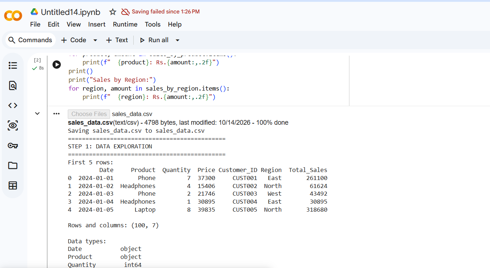
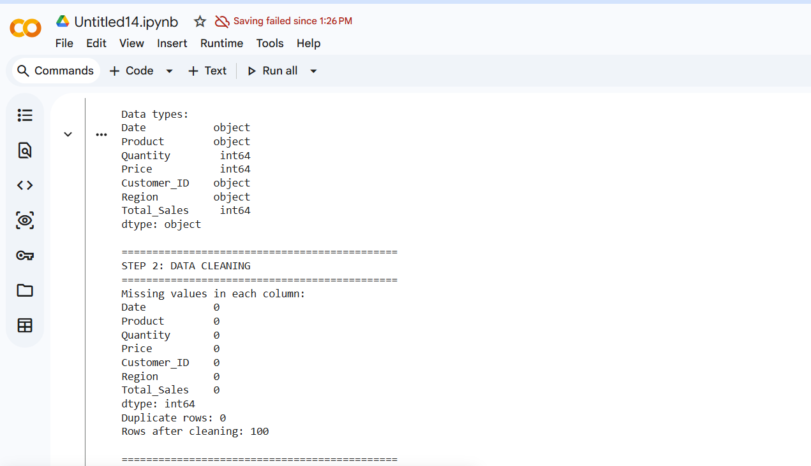
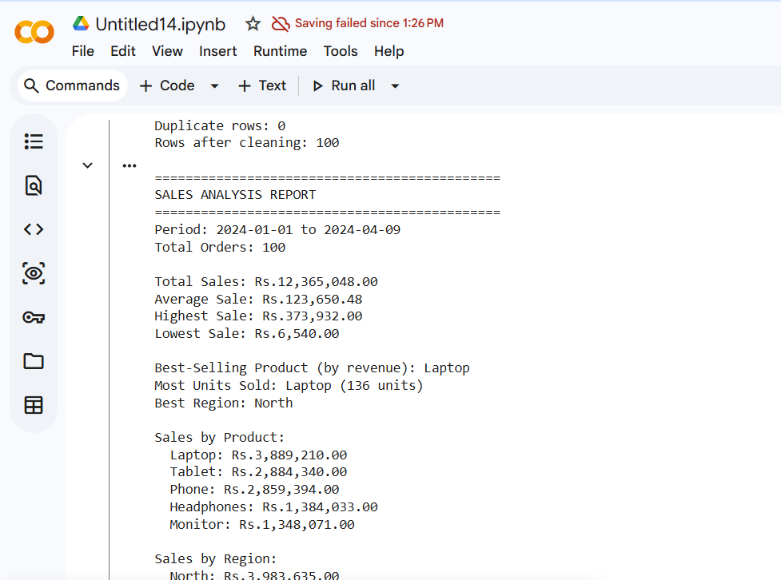
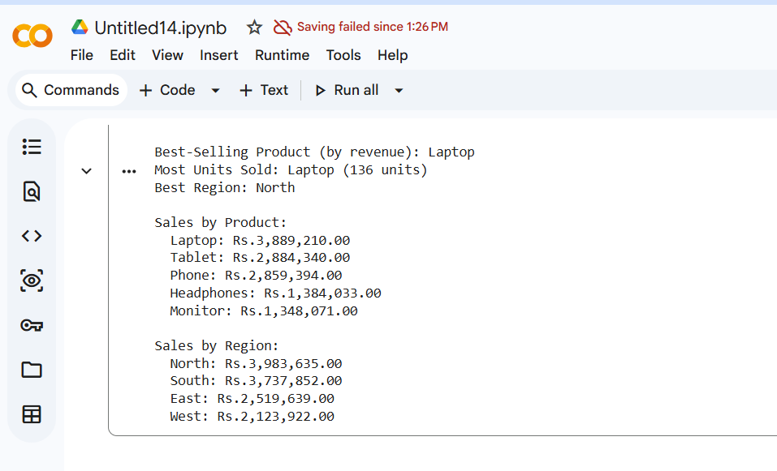

# Sales Data Analysis

## Project Overview
A Python program that uses pandas to analyze a sales dataset of 100 orders. It finds the total sales, the best-selling product and the best region, and prints a clean report. The goal is to practice loading data, cleaning it, and calculating simple statistics.

## Setup Instructions
1. Install Python 3 from python.org (or use Google Colab, which needs no installation).
2. Install pandas by running: pip install pandas
3. Download sales_analysis.py and sales_data.csv from this repository and keep them in the same folder.
4. Run the program with: python sales_analysis.py

## Code Structure
- sales_analysis.py : the main analysis program
- sales_data.csv : the dataset (100 rows, 7 columns)
- analysis_report.md : the written analysis steps and findings
- requirements.txt : the libraries needed (pandas)
- screenshots/ : screenshots of the program output

## Visual Documentation
Data exploration:

Data cleaning:

Sales analysis report:

Sales by product and region:

## Technical Details
- pandas (pd.read_csv) loads the CSV file into a DataFrame.
- df.head(), df.shape and df.dtypes are used to explore the data.
- df.isnull().sum() and df.duplicated().sum() check for missing values and duplicates. dropna() and drop_duplicates() clean the data.
- pd.to_datetime() converts the Date column into real dates.
- sum(), mean(), max() and min() calculate the main metrics.
- groupby() with sum() finds the sales by product and by region, and sort_values() finds the best ones.
- f-strings print the final formatted report.

## Testing Evidence
- The data had 100 rows and 7 columns, with 0 missing values and 0 duplicate rows, so all 100 rows were kept.
- Total sales matched a manual check: Rs.12,365,048.
- Total_Sales equals Quantity x Price for every row, so the data is consistent.
- The screenshots above show the program running without errors.

## Key Results
- Total Sales: Rs.12,365,048
- Best-Selling Product: Laptop (Rs.3,889,210)
- Best Region: North (Rs.3,983,635)

The full explanation is in analysis_report.md.

## What I Learned
I learned how to use pandas to load a CSV file, explore and clean data, calculate statistics, group data by category, and present the results in a clear report. I also learned how to organize a data project on GitHub.
